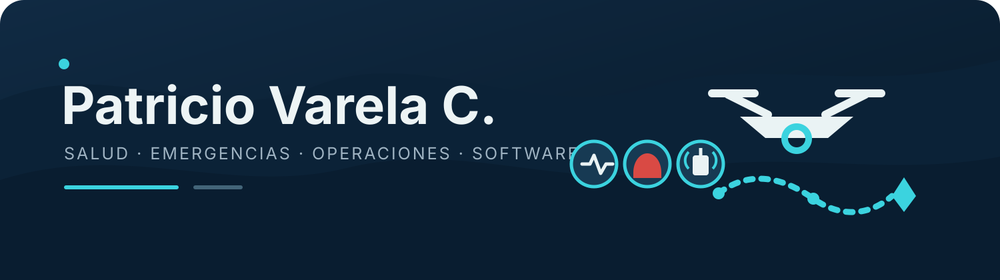
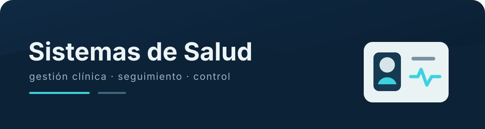
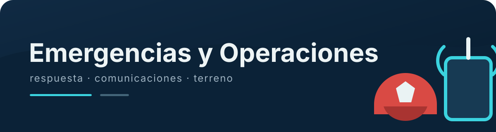
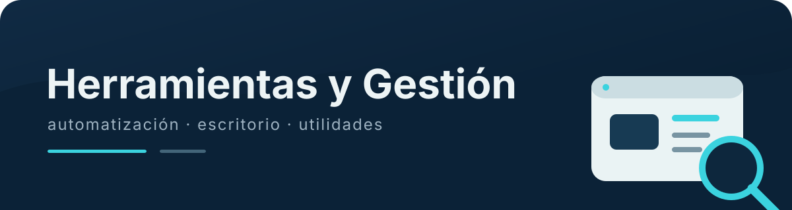

  

# Patricio Varela C.

**Desarrollo de software y soluciones digitales** · Coquimbo, Chile 🇨🇱 · CA2OPX

Me dedico al desarrollo de **sistemas de gestión, aplicaciones web y herramientas de escritorio**. Mis proyectos abordan necesidades concretas en salud, emergencias, administración, logística y operaciones de terreno.

Trabajo desde el análisis del problema hasta la implementación y el mantenimiento: organización de datos, automatización de procesos, interfaces prácticas, documentación, pruebas y respaldos. En este perfil reúno proyectos en uso, desarrollos experimentales y trabajos históricos, identificados según su estado real.

## Proyecto destacado: VantOPS Chile

  

**[Abrir aplicación web](https://2674321.github.io/vantops-chile/)** · **[Mapa de operaciones](https://2674321.github.io/vantops-chile/#/utilidades/mapa)** · **[Código y documentación](https://github.com/2674321/vantops-chile)**

VantOPS Chile es una **PWA gratuita y de código abierto para apoyo a operaciones RPAS**: reúne meteorología de referencia, mapas con radios personalizables, preparación de operaciones y bitácora local, sin exigir cuentas. **Estado actual verificado:** `v1.1.0-beta.2`, publicada en GitHub Pages; no reemplaza permisos o normativa aeronáutica de la DGAC.

## Proyectos en imágenes

Capturas de aplicaciones y demostraciones públicas. Cada proyecto mantiene su documentación y estado por separado.

| Guardias (demo) | VantOPS Chile |
|---|---|
|  |  |
| Guía de radiocomunicaciones | PernoLabel |
|  |  |

## Tecnologías

Utilizo **Google Apps Script y Sheets** para sistemas integrados, **JavaScript/TypeScript y React** para aplicaciones web, **Python y SQLite** para herramientas locales, y **Ruby/GTK3** para utilidades de escritorio. También desarrollo flujos de documentos PDF y verificaciones automatizadas. Elijo la tecnología según la necesidad de cada proyecto, no al revés.

  

<table>
<tr>
<td align="center" width="50%">
 
<b>ECICEP</b> 
Captura y gestión clínica por sectores, informes REM y control de calidad de datos.
</td>
<td align="center" width="50%">
 
<b>Seguimiento Clínico PADI</b> 
Seguimiento clínico PADI: pacientes, controles, vigencias y agenda.
</td>
</tr>
<tr>
<td align="center">
 
<b>Control de Carro de Paro</b> 
Control de stock, revisiones diarias y vencimientos en SAPU y móviles.
</td>
<td align="center">
 
<b>Aurea Salud</b> 
Prototipo formativo de salud y telemedicina, no productivo.
</td>
</tr>
</table>

  

<table>
<tr>
<td align="center" width="50%">
 
<b>Sistema de Guardias</b> 
Calendario de guardias, cupos, asistencia y administración operativa.
</td>
<td align="center" width="50%">
 
<b>Defensa Civil</b> 
Gestión de voluntarios, convocatorias, entregas e inventario.
</td>
</tr>
<tr>
<td align="center">
 
<b>Asistencia Digital Bomberos</b> 
PWA de asistencia offline; proyecto histórico descontinuado.
</td>
<td align="center">
 
<b>Guía de Radiocomunicaciones</b> 
Guías web y PDF de códigos, claves y protocolos de radiocomunicación.
</td>
</tr>
<tr>
<td align="center" colspan="2">
 
<b>VantOPS Chile</b> 
PWA gratuita de apoyo RPAS: meteorología de referencia, mapa de radios, preparaciones y bitácora local.
</td>
</tr>
</table>

  

<table>
<tr>
<td align="center" width="50%">
 
<b>Sistema de Cotizaciones</b> 
Cotizaciones PDF mediante Python y WeasyPrint, con QR e integridad documental.
</td>
<td align="center" width="50%">
 
<b>PernoLabel</b> 
Aplicación Ruby/GTK3 para etiquetas PDF Code128 y QR desde planillas.
</td>
</tr>
<tr>
<td align="center">
 
<b>Seguimiento de Baterías</b> 
Aplicación histórica Ruby/GTK3 para seguimiento y respaldo de baterías.
</td>
<td align="center">
 
<b>GitHub Repository Auditor</b> 
CLI Python para auditorías reproducibles de Git y GitHub.
</td>
</tr>
<tr>
<td align="center" colspan="2">
 
<b>PernoStock Web</b> 
Primer sitio web desarrollado; conservado como proyecto histórico.
</td>
</tr>
</table>

## Otros desarrollos

También trabajo en **sistemas administrativos y contables de uso interno**. Esos repositorios permanecen privados para separar el código y la información operativa de los proyectos publicados.

## Criterios de desarrollo

**Utilidad real · integridad de datos · separación de responsabilidades · validaciones claras · pruebas de regresión · trazabilidad · respaldos · documentación · mantenimiento.**

Las demostraciones de los repositorios públicos emplean datos ficticios cuando corresponde. Los proyectos experimentales o discontinuados se identifican como tales.

El catálogo histórico y la convención local de proyectos se mantienen en [PROJECT_CATALOG.md](PROJECT_CATALOG.md). Las reglas comunes de seguridad, visibilidad, estados y flujo de cambios están en [PORTFOLIO_GOVERNANCE.md](PORTFOLIO_GOVERNANCE.md).

## Contacto

**CA2OPX** · Coquimbo, Chile 🇨🇱  
**ORCID:** [0009-0002-1087-9445](https://orcid.org/0009-0002-1087-9445)
